

<a href="https://gakdo.site">
  
</a>

<h1>TRACE</h1>

<strong>AI 비전과 해시 체인으로 증명하는 렌탈 노트북 상태 기록 서비스</strong>

📅 <b>개발 기간</b> : 2026.10.30 ~ 2026.11.16 &nbsp;·&nbsp; 🏆 2026 조선대학교 IT Festival 캡스톤 &nbsp;·&nbsp; 👥 팀 GAKDO

 

| 📖 도메인 | 📋 API 명세서 | 🧭 처음 보는 분을 위한 안내서 |
|:---:|:---:|:---:|
| [gakdo.site](https://gakdo.site) | [gakdo.github.io/docs/api/mvp.html](https://gakdo.github.io/docs/api/mvp.html) | [gakdo.github.io/docs/guide](https://gakdo.github.io/docs/guide/) |

## ✦ 무엇을 해결하나요

노트북을 빌리고 돌려줄 때마다 "이 흠집, 원래 있던 거예요"라는 다툼이 생깁니다. TRACE는 **출고 · 수령 · 반납** 세 시점에 같은 방식으로 사진을 남기고, AI가 흠집 후보를 찾고, 사람이 확정한 기록만 **해시 체인으로 봉인**합니다. 봉인된 기록은 누구나 검증 페이지에서 고쳐지지 않았는지 확인할 수 있습니다.

<table>
  <tr>
    <td width="33%" valign="top">
      <h3>📸 같은 조건으로 찍기</h3>
      부스 Jetson이 카메라 2대 × 조명 3개로 윗면·아랫면을 찍습니다. 수령 때는 고객이 QR로 들어와 폰으로 찍습니다.
    </td>
    <td width="33%" valign="top">
      <h3>🔍 AI는 넓게, 사람은 확실하게</h3>
      YOLO11-seg가 흠집 후보를 폴리곤으로 넓게 잡고, 관리자가 후보마다 확정·기각합니다. 확정한 흠집만 등급 A~D에 들어갑니다.
    </td>
    <td width="33%" valign="top">
      <h3>🔗 고칠 수 없는 기록</h3>
      시점마다 이전 기록의 해시를 이어 붙이고 Ed25519로 서명합니다. 한 글자만 바뀌어도 검증에서 바로 드러납니다.
    </td>
  </tr>
</table>

  

## ✦ 주요 기능

<table>
  <tr>
    <td width="50%" valign="top">
      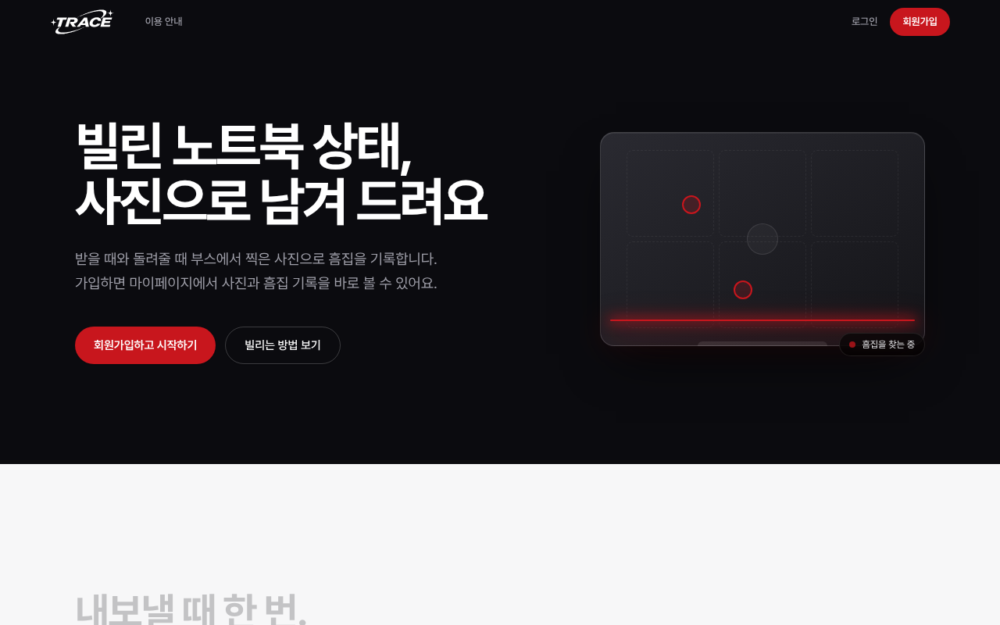
      <b>첫 화면 · 이용 안내</b> 가입하면 마이페이지에서 내가 빌린 노트북의 사진과 흠집 기록을 바로 봅니다.
    </td>
    <td width="50%" valign="top">
      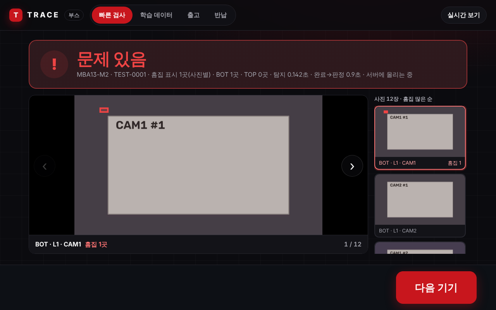
      <b>부스 빠른 검사</b> Jetson이 12장을 찍고 TensorRT로 탐지해 1초 안팎으로 "문제 있음/없음"을 띄웁니다.
    </td>
  </tr>
  <tr>
    <td width="50%" valign="top">
      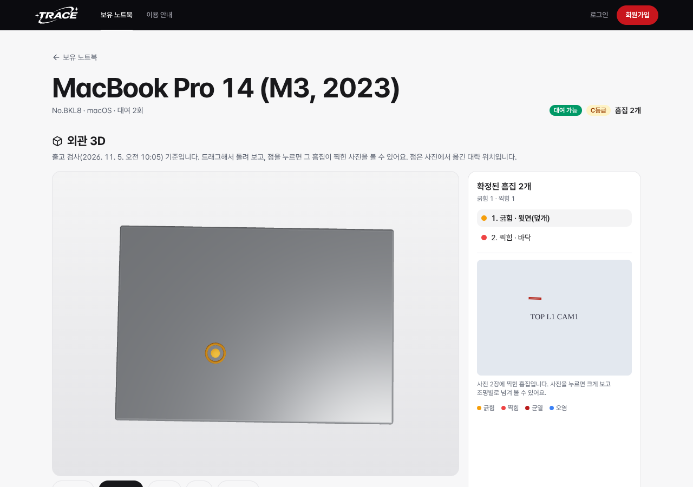
      <b>보유 노트북 · 외관 3D</b> 로그인 없이 기기를 비교하고, 3D 위의 점을 누르면 그 흠집이 찍힌 사진을 봅니다.
    </td>
    <td width="50%" valign="top">
      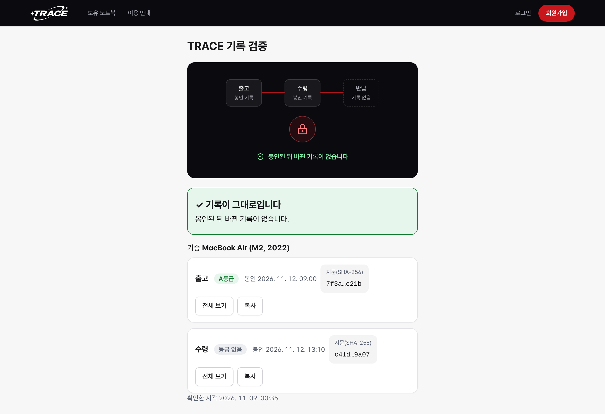
      <b>기록 검증</b> 봉인 영수증의 링크로 누구나 해시 체인과 서명을 다시 계산해 기록이 그대로인지 확인합니다.
    </td>
  </tr>
</table>

<b>기능 전체 보기</b>

| 누가 | 기능 |
|---|---|
| 관리자 | 기종·기기 등록(라벨 사진 글자 읽기), 렌탈 열기, 출고·반납 시점 시작, 흠집 후보 확정·기각, 검사 결과·등급 보기, 렌탈 전후 진단 비교 |
| 부스 | 기다리는 기기 고르기, 12장 촬영, Jetson 흠집 탐지, 사진 직접 업로드, 학습 데이터 촬영 |
| 고객 | 수령 QR 하나로 가입·로그인과 렌탈 연결, 폰으로 수령 촬영, 출고 사진과 나란히 비교, 3D 리포트, 봉인 영수증 메일 |
| 누구나 | 보유 노트북 목록·3D 흠집 위치, 기록 검증 페이지 |
| 진단 에이전트 | 페어링 코드로 연결, 배터리·SSD·부품·잠금 상태 수집, 진단 JSON 검증 후 동의하면 업로드 |

## ✦ 👥 팀원

<table align="center">
  <tbody>
    <tr>
      <td align="center" width="200">
        <a href="https://github.com/kim75503">
          
           <b>김민서</b>
        </a>
         <b>A · 서버 6개 · 인프라 계약 · AI 학습</b>
      </td>
      <td align="center" width="200">
        <a href="https://github.com/iamminseo">
          
           <b>나민서</b>
        </a>
         <b>B · 부스 Jetson 앱 진단 에이전트 · 학습 촬영</b>
      </td>
      <td align="center" width="200">
        <a href="https://github.com/practicech">
          
           <b>강성찬</b>
        </a>
         <b>C · 웹 화면 · 폰 촬영 3D 리포트 · 검증 페이지</b>
      </td>
    </tr>
  </tbody>
</table>

Spec Kit으로 명세 → 계획 → 작업 → 구현 순서를 지키고, 계약(contracts)을 먼저 고정한 뒤 레포마다 따로 개발합니다.

## ✦ 💻 Tech Stacks

| 구분 | 기술 스택 |
| :--- | :--- |
| **Frontend** |      |
| **Backend** |       |
| **Database · Messaging** |     |
| **AI · Vision** |       |
| **Edge · Agent** |     |
| **Infrastructure** |     |
| **Contract · Quality** |      |
| **Collaboration** |     |

## ✦ 🏗 System Architecture

  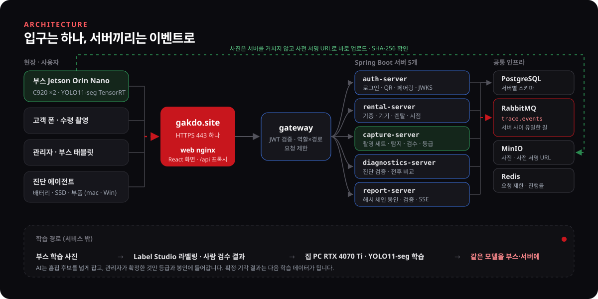

> 서비스마다 레포·이미지·DB 스키마가 따로인 **마이크로서비스**입니다. 서버끼리는 REST로 서로 부르지 않고 이벤트로만 주고받아, 한 서버가 멈춰도 다른 서버의 기록은 남습니다.

<b>1. 입구와 보안</b>

- **gakdo.site (HTTPS 443)**: 화면·API·사진 업로드가 모두 이 하나의 입구로 들어옵니다. web nginx가 화면을 주고 `/api`를 gateway로 넘깁니다.
- **gateway**: 모든 API의 단일 진입점입니다. auth-server의 JWKS로 JWT를 검증하고, 역할(ADMIN·CUSTOMER·BOOTH·AGENT) × 경로 표로 막고, Redis로 요청 수를 제한합니다.
- **비밀값**: 코드·문서·커밋에 넣지 않고 환경 변수로만 받으며, 모든 레포에서 gitleaks로 검사합니다.

<b>2. 마이크로서비스</b>

| 서비스 | 하는 일 |
|---|---|
| **auth-server** | 회원 가입·로그인, 수령 QR 하나로 렌탈 연결, 부스·에이전트 토큰, 진단 페어링 코드, JWKS, 봉인 영수증 메일 |
| **rental-server** | 기종·기기·렌탈과 출고·수령·반납 시점 상태(OPEN → CAPTURED → GRADED → SEALED) |
| **capture-server** | 촬영 세트, 사전 서명 업로드 URL, 사진 해시 확인, 탐지 결과 저장, 사람 검수, 등급 A~D, 시점 비교 |
| **diagnostics-server** | 진단 JSON 검증, 렌탈 전후 비교, 점검 플래그(배터리 급감·부품 바뀜 등) |
| **report-server** | 렌탈별 해시 체인 연결, Ed25519 서명, 리포트, 공개 검증, 진행률 SSE |
| **inspect-worker** | 고객 폰 사진을 부스와 같은 모델로 검사(ONNX, CPU) |

<b>3. 데이터와 메시징</b>

- **PostgreSQL**: 서버마다 스키마를 나눕니다(auth · rental · capture · inspection · diagnostics · report). 다른 서버의 데이터는 외래 키 대신 공개 ID로만 가리킵니다.
- **RabbitMQ `trace.events`**: `capture.uploaded` → `checkpoint.graded` → `record.sealed`처럼 시점 상태가 이벤트로 흘러갑니다. 같은 이벤트를 두 번 받아도 한 번만 처리합니다.
- **MinIO**: 사진은 서버를 거치지 않고 사전 서명 URL로 바로 올라가며, 올린 뒤 SHA-256으로 확인합니다.
- **Redis**: 요청 제한과 진행률 알림에 씁니다.

<b>4. AI 파이프라인</b>

- 부스에서 노트북 15대를 조명별로 찍어 Label Studio로 흠집 폴리곤을 그리고, 집 PC(RTX 4070 Ti)에서 YOLO11-seg를 640px 타일로 학습합니다.
- 학습한 모델은 ONNX로 내보내 **부스 Jetson(TensorRT FP16)과 서버 inspect-worker(ONNX CPU)에 같은 버전**으로 올립니다.
- AI는 후보를 넓게 잡고 관리자가 확정·기각합니다. 그 결과는 `trace-ml review export`로 다음 학습 데이터가 됩니다.

## ✦ 🔁 CI/CD

  

- 레포마다 같은 워크플로를 씁니다: `backend-ci`(서버 6개), `화면 CI`(web), `python-ci`(booth·agent·ml), `계약 검사`(contracts), `비밀값 검사`·`release`·`PR 알림`(전부).
- 계약(OpenAPI·JSON Schema·코드 값)은 contracts가 원본입니다. 바꿔야 하면 코드보다 계약을 먼저 고칩니다.

## ✦ 🧪 SonarQube 품질 게이트

서버 6개 모두 push마다 `backend-ci`에서 SonarQube 분석을 돌리고, 아래 품질 게이트를 통과해야 머지합니다.

| 조건 (새 코드 기준) | 기준 |
|---|---|
| 테스트 커버리지 | 80% 이상 |
| 중복 코드 | 3% 이하 |
| 새 이슈 | 0건 |
| 보안 핫스팟 검토 | 100% |

| 서버 | 게이트 | 새 코드 커버리지 |
|---|:---:|:---:|
| [auth_server](https://github.com/GAKDO/auth_server) | ✅ Passed | 82.6% |
| [gateway](https://github.com/GAKDO/gateway) | ✅ Passed | 100% |
| [capture_server](https://github.com/GAKDO/capture_server) | ✅ Passed | 88.4% |
| [rental_server](https://github.com/GAKDO/rental_server) | ✅ Passed | 90.3% |
| [diagnostics_server](https://github.com/GAKDO/diagnostics_server) | ✅ Passed | 85.2% |
| [report_server](https://github.com/GAKDO/report_server) | ✅ Passed | 83.0% |

<b>auth-server</b> · Quality Gate Passed · 커버리지 82.6%

 

  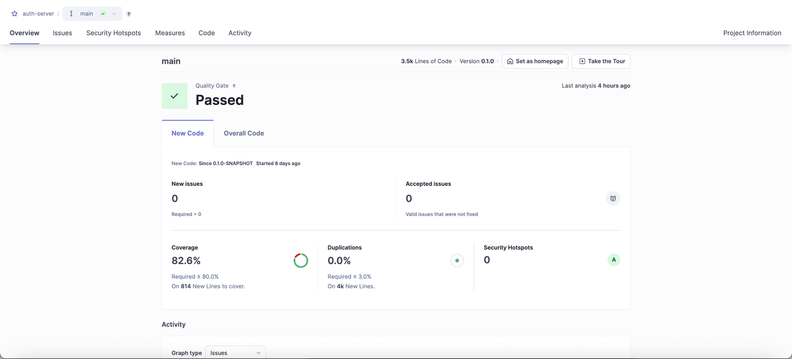

<b>gateway</b> · Quality Gate Passed · 커버리지 100%

 

  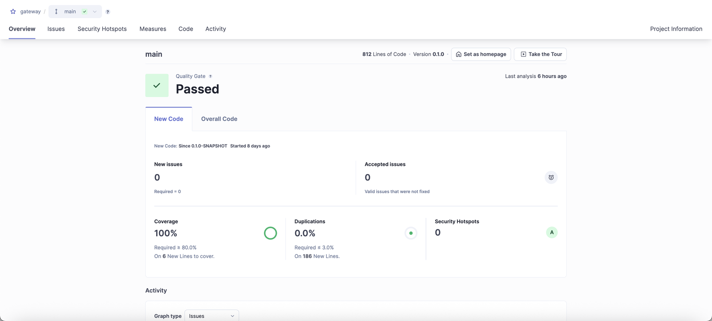

<b>capture-server</b> · Quality Gate Passed · 커버리지 88.4%

 

  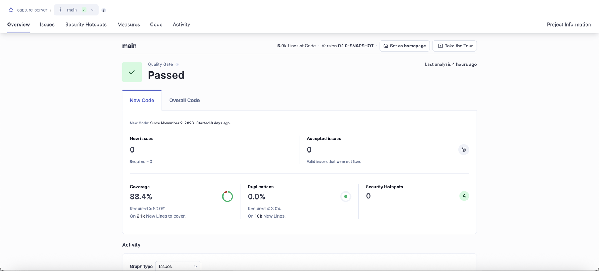

<b>rental-server</b> · Quality Gate Passed · 커버리지 90.3%

 

  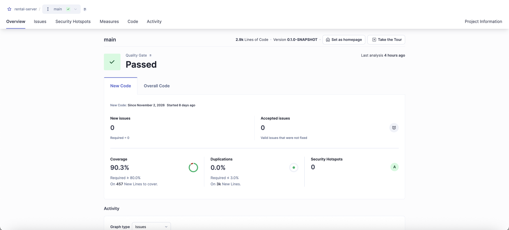

<b>diagnostics-server</b> · Quality Gate Passed · 커버리지 85.2%

 

  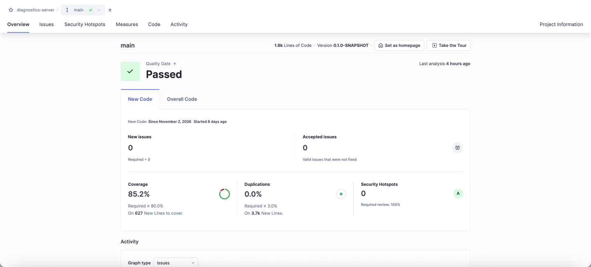

<b>report-server</b> · Quality Gate Passed · 커버리지 83.0%

 

  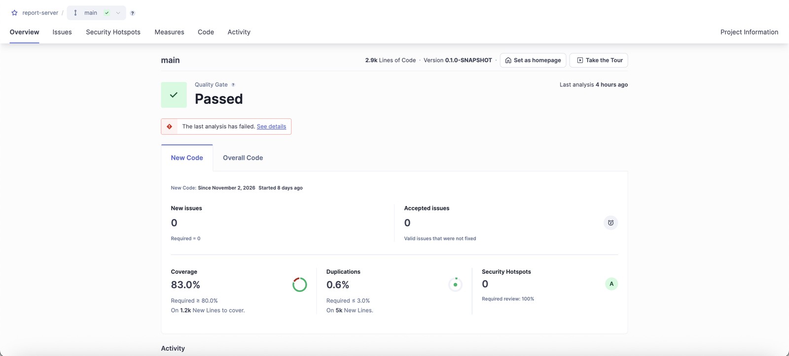

2026.11.10 기준 화면입니다.

## ✦ 📊 AI 탐지 결과 (v004)

학습에 한 번도 쓰지 않은 기기 3대로 쟀습니다. mAP보다 **누가 손해를 보나**로 셉니다.

| 지표 | 결과 |
|---|---|
| 놓친 흠집 기기 면(회사 손해) | **0 / 4** (흠집 있는 면 모두 찾음) |
| 청구로 이어진 오탐(고객 손해) | **0건**: AI는 후보만, 관리자가 확정한 것만 등급·정산 |
| 검증 사진 정밀도 / 재현율 | 0.71 / 0.60 (오탐 사진 15장, 이전 모델 48장) |
| 부스 Jetson 탐지 시간 | 12장 **2.53초** (TensorRT FP16, 목표 30초) |

측정 조건과 판마다 바꾼 것: [docs `contest/metrics/M3.md`](https://github.com/GAKDO/docs/blob/main/contest/metrics/M3.md)

## ✦ 🔒 개인정보 원칙

1. 사진은 **기기 외관만** 찍습니다. 공개 검증 페이지에는 해시·시각·등급만 있고 사람 정보는 없습니다.
2. 밖으로 나가는 곳은 **메일(Gmail)과 챗봇(Gemini) 두 곳**뿐입니다. 챗봇에는 기기 일련번호를 뒤 4자리만 보내고, 테스트로 확인합니다.
3. AI(챗봇·trace-mcp)는 **읽기만** 합니다. 봉인된 기록은 운영자도 고칠 수 없습니다.

## ✦ 📚 오픈소스와 라이선스

<b>우리가 쓴 오픈소스·모델·데이터</b> (우리가 만든 부분과 구분)

 

| 이름 | 쓰는 곳 | 라이선스 |
|---|---|---|
| Ultralytics YOLO11-seg | 흠집 탐지 모델 구조·학습 도구 | AGPL-3.0 |
| AI Hub 공개 데이터 | 탐지 사전학습 | AI Hub 이용 약관 |
| OpenCV, LightGlue | 9면 정합 | Apache-2.0 |
| MinIO | 사진 저장소 | AGPL-3.0 |
| Ollama + qwen2.5:3b, Google Gemini API | 사이트 챗봇 | MIT + Qwen Research License, Google API 약관 |
| Spring Boot · Spring Cloud Gateway · Nimbus JOSE | 서버 | Apache-2.0 |
| React · Vite · three.js · React Three Fiber | 웹 | MIT |
| PostgreSQL · RabbitMQ · Redis | 인프라 | PostgreSQL · MPL-2.0 · RSALv2/SSPLv1 |

부스 사진 라벨링과 미세조정 가중치, 세 시점 비교·등급·정산 규칙, 해시 체인 봉인과 검증 페이지, 서버·웹·부스·에이전트 코드는 팀이 직접 만들었습니다. 상용화 때 AGPL·비상업 구성 요소를 어떻게 바꿀지는 [docs `contest/open-source-and-privacy.md`](https://github.com/GAKDO/docs/blob/main/contest/open-source-and-privacy.md)에 있습니다.

## ✦ 🗂 ERD

  <a href="https://raw.githubusercontent.com/GAKDO/.github/main/profile/assets/erd.svg">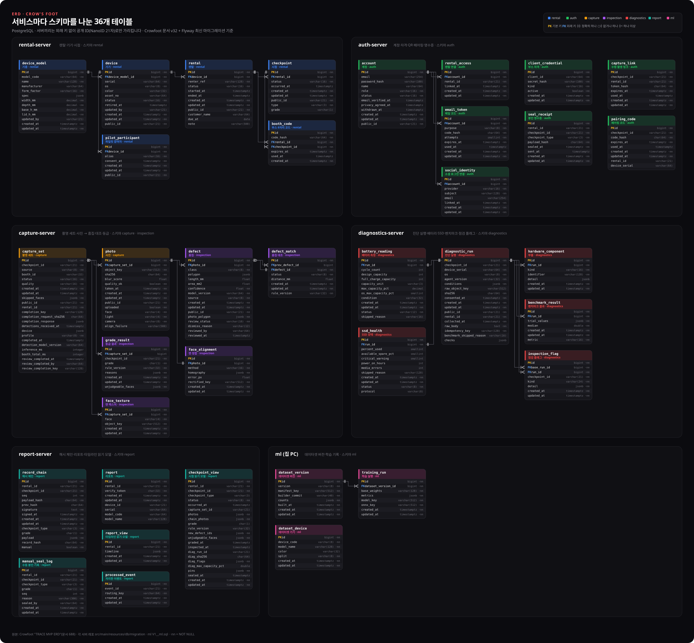</a>

> 그림을 누르면 원본 크기로 열립니다. 서버마다 PostgreSQL 스키마를 나누고(rental · auth · capture · inspection · diagnostics · report · ml), 서버끼리는 외래 키 없이 공개 ID로만 가리킵니다.

전체 DDL은 [docs `db/V1__init.sql`](https://github.com/GAKDO/docs/blob/main/db/V1__init.sql)과 [`design/ddl.md`](https://github.com/GAKDO/docs/blob/main/design/ddl.md), 이후 변경은 각 서버 레포의 `src/main/resources/db/migration`에 있습니다.

## ✦ 📦 레포지토리

| 레포 | 하는 일 | 기술 |
|---|---|---|
| [**web**](https://github.com/GAKDO/web) | 관리자 화면 · 폰 촬영 · 3D 리포트 · 검증 페이지 | React 18 · TypeScript · Vite · R3F |
| [**gateway**](https://github.com/GAKDO/gateway) | JWT 검증 · 라우팅 · 요청 제한 | Spring Cloud Gateway · Redis |
| [**auth_server**](https://github.com/GAKDO/auth_server) | 회원 · 로그인 · QR · 페어링 · JWKS · 봉인 영수증 메일 | Spring Boot 3.5 · Nimbus JOSE |
| [**rental_server**](https://github.com/GAKDO/rental_server) | 기종 · 기기 · 렌탈 · 시점 | Spring Boot 3.5 · JPA · Flyway |
| [**capture_server**](https://github.com/GAKDO/capture_server) | 촬영 세트 · 사전 서명 URL · 탐지 · 검수 · 등급 | Spring Boot 3.5 · AWS SDK v2 |
| [**diagnostics_server**](https://github.com/GAKDO/diagnostics_server) | 진단 검증 · 렌탈 전후 비교 · 점검 플래그 | Spring Boot 3.5 · JSON Schema |
| [**report_server**](https://github.com/GAKDO/report_server) | 타임라인 · 해시 체인 · 검증 · SSE | Spring Boot 3.5 · Ed25519 |
| [**booth**](https://github.com/GAKDO/booth) | 부스 Jetson 앱 · 학습 데이터 촬영 도구 | Python · OpenCV · TensorRT |
| [**agent**](https://github.com/GAKDO/agent) | 노트북 진단 에이전트 (macOS · Windows) | Python |
| [**ml**](https://github.com/GAKDO/ml) | 사진 검사 워커 · 데이터셋 빌더 · 학습 | PyTorch · YOLO11-seg · ONNX |
| [**contracts**](https://github.com/GAKDO/contracts) | OpenAPI · 진단 JSON Schema · 이벤트 스키마 · 코드 값 | OpenAPI 3.1 · JSON Schema |
| [**gitops**](https://github.com/GAKDO/gitops) | 배포 구성 | Docker Compose |
| [**docs**](https://github.com/GAKDO/docs) | 설계서 · 결정 기록 · 안내서 · 팀 운영 | Markdown · Spec Kit |

 

  <a href="https://gakdo.site"><b>gakdo.site</b></a> · <a href="https://gakdo.github.io/docs/api/mvp.html">API 명세서</a> · <a href="https://github.com/GAKDO/docs">docs</a> · <a href="https://github.com/GAKDO/contracts">contracts</a>
    
  

